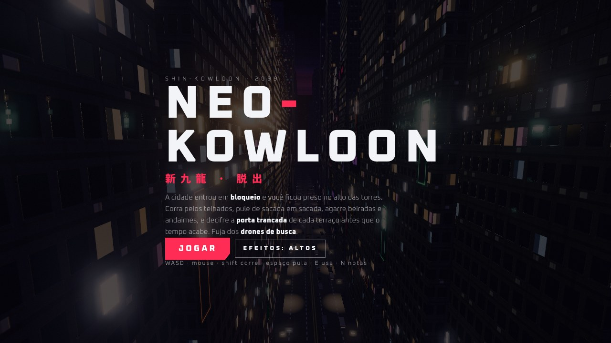
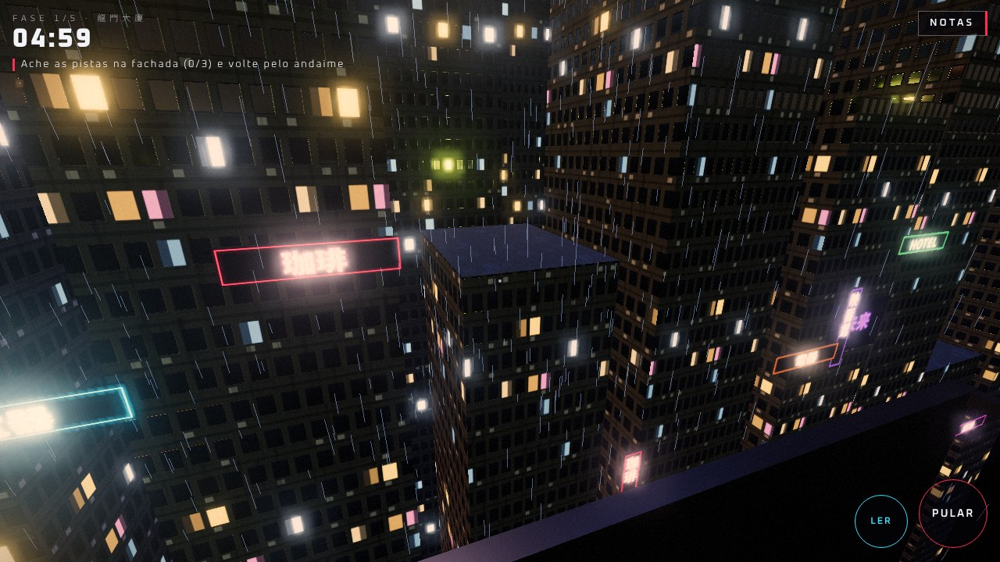
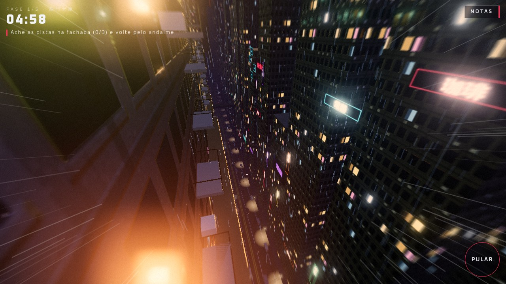
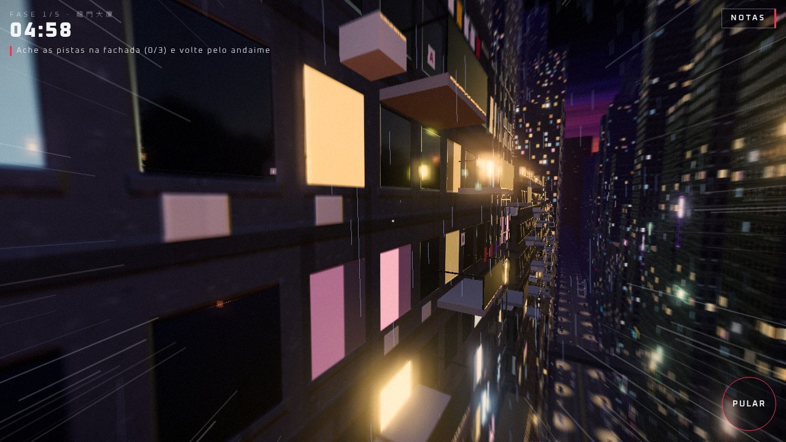
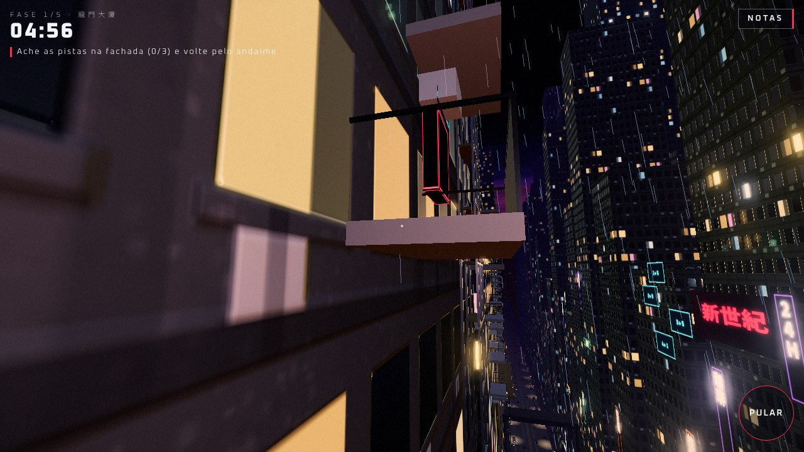
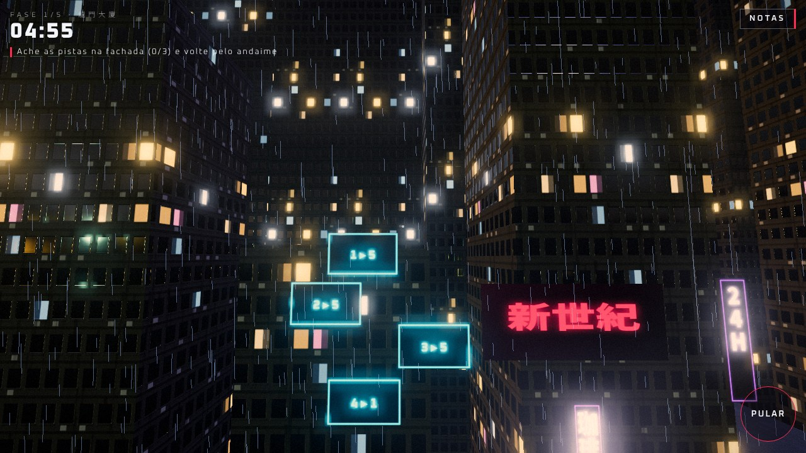
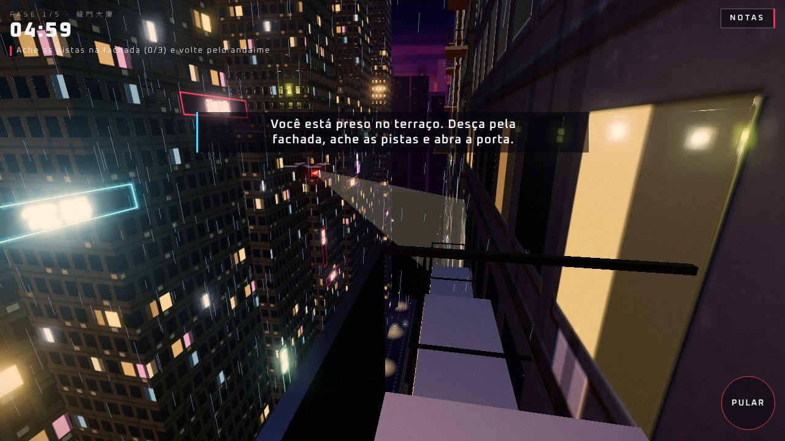
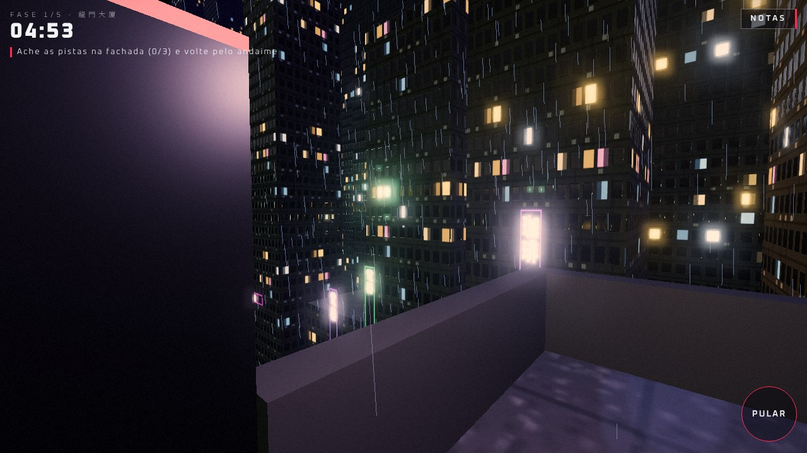
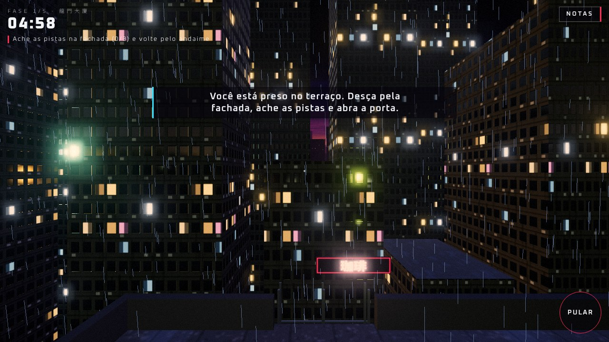

  

<h1 align="center">NEO-KOWLOON 新九龍</h1>

  <b>Jogo de parkour e escape room em primeira pessoa para Android.</b> 
  A cidade entrou em bloqueio e você ficou preso no alto das torres. Corra pelos telhados, salte de sacada em sacada, agarre andaimes e decifre a porta de cada terraço antes que o tempo acabe.

  

---

## O jogo

Um distrito cyberpunk de arranha-céus colados uns aos outros, com chuva, letreiros de neon e uma avenida cheia de carros 120 metros abaixo. Cada prédio é uma fase: você desce pela fachada em zigue-zague, de sacada em sacada, procura a pista escondida no caminho, volta ao telhado pelo andaime e digita o código na porta do terraço. Quando ela abre, uma ponte desce até o próximo prédio.

No último telhado, uma tirolesa leva até a estação do trem elevado, e a fuga termina.

## Telas

| A avenida lá embaixo | Vertigem |
|:---:|:---:|
|  |  |

| Pela fachada | O letreiro que pisca |
|:---:|:---:|
|  |  |

| Os telões do outro lado | Drone de busca |
|:---:|:---:|
|  |  |

| A tirolesa | A porta do terraço |
|:---:|:---:|
|  |  |

## Mecânicas

- **Parkour:** pulos entre sacadas, agarrar bordas e subir, escalar andaimes e descer de tirolesa.
- **5 fases, 5 minutos cada:** o relógio corre, e cada fase tem um enigma diferente.
- **Pistas no cenário:** números pintados com símbolos, um neon que pisca uma sequência, varais de roupa, telões na avenida e, no fim, um código montado com tudo o que você já resolveu.
- **Drones com holofote:** patrulham a fachada. Ser visto custa 20 segundos.
- **Quedas de verdade:** cair alto demais leva você de volta ao último ponto salvo.
- **Visual de anime cyberpunk:** neon, chuva, asfalto molhado refletindo as luzes e brilho cinematográfico. Dá para escolher efeitos leves em celulares mais simples.

## Tecnologias

Three.js (3D) · JavaScript · Capacitor (Android) · Web Audio · GitHub Actions

---

© 2026 Davi Barros de Lima. Todos os direitos reservados. O código-fonte deste projeto é privado, e este repositório reúne só a apresentação do jogo. Consulte o arquivo <a href="LICENSE">LICENSE</a>.
